# Process Characterization & Optimization with DOE and MSA

**The problem:** Before a deposition process can be released or matched across chambers, an engineer has to answer four questions with data: *Can I trust my measurements? Which knobs actually matter? Where is the best operating window? Where does my variation come from?* This project answers each one with standard process engineering statistics, run in **JMP** and checked in **Python**.

**Case study:** a simulated single-wafer PECVD silicon nitride (SiNx) process across four chambers, plus real fab sensor data (UCI SECOM) for yield analysis.

> **Status:** Complete. All six steps are analyzed in JMP and reproduced in Python.

## Results at a glance

| Step | Question | Answer |
|---|---|---|
| 2. Gauge R&R | Can I trust my measurements? | Thickness gauge yes (7.5% GRR). Stress gauge marginal (29%, 4 distinct categories) because of instrument repeatability; averaging 3 readings fixes it. |
| 3. Screening DOE | Which knobs matter? | NH3/SiH4 ratio sets rate and RI; uniformity is driven by interactions; temperature is an independent stress knob; strong curvature everywhere. |
| 4. Response surface | Where is the best operating window? | One recipe hits rate, uniformity, RI and stress targets. Confirmation runs caught a 10 MPa model bias that temperature then corrected. |
| 5. Fleet matching | Where does my variation come from? | 83% from chamber-to-chamber differences. Per-chamber deposition time took fleet Ppk from 0.57 to 1.28 and out-of-spec wafers from 4 to 0. |
| 6. Real fab data (SECOM) | Can sensor data predict yield? | Not reliably across time. A model that scores ROC AUC 0.74 in random cross-validation drops to 0.56 on later production, because the failure drivers drift. |

---

## Plan

| Step | Method | Tool | Status |
|---|---|---|---|
| 1. PECVD chamber simulator | Physics-informed response model, 49-point wafer maps, 4 chambers | Python | Done |
| 2. Measurement system analysis | Crossed Gauge R&R (ellipsometer, stress gauge) | JMP + Python | Done |
| 3. Factor screening | 2^(5-1) fractional factorial | JMP + Python | Done |
| 4. Process window optimization | Central composite RSM, multi-response desirability, confirmation runs | JMP + Python | Done |
| 5. Variance sources and chamber matching | Nested variance components, ANOVA, Tukey, equivalence (TOST), Ppk | JMP + Python | Done |
| 6. Yield driver analysis (real data) | Data cleaning, predictor screening, FDR, PCA, classification with time-ordered validation on UCI SECOM | JMP + Python | Done |

## Results

### Step 2: Gauge R&R

A crossed study with 10 wafers × 3 operators × 3 trials, run in random order and analyzed with the AIAG ANOVA method in JMP (Variability Chart → Gauge R&R, k = 6). `src/gauge_rr.py` reproduces every number to rounding.

| Gauge | % GRR (study var.) | % Tolerance | Distinct categories | Verdict |
|---|---|---|---|---|
| Ellipsometer: thickness | 7.5% | 5.5% | 18 | Acceptable |
| Ellipsometer: refractive index | 19.6% | 14.3% | 7 | Marginal |
| Stress gauge | 29.4% | 20.5% | **4** | Marginal, cannot reliably tell wafers apart |

**Findings**
- **The thickness data can be trusted as-is** for the DOE.
- **The stress gauge needs action before a stress DOE.** It sits at the edge of AIAG's 30% limit, and with 4 distinct categories (AIAG requires at least 5) it can't reliably separate wafers. Repeatability (17.1% of tolerance) is larger than reproducibility (11.2%), so the problem is **the instrument, not the operators**.
- **Recommended fix: average 3 readings per wafer.** That cuts the repeatability SD by a factor of √3 and brings the gauge to about 22% GRR with 6 distinct categories, without new hardware. Then reproducibility becomes the larger term, and the next lever is a standard measurement procedure for all operators.

| Thickness | Refractive index | Stress |
|---|---|---|
|  | 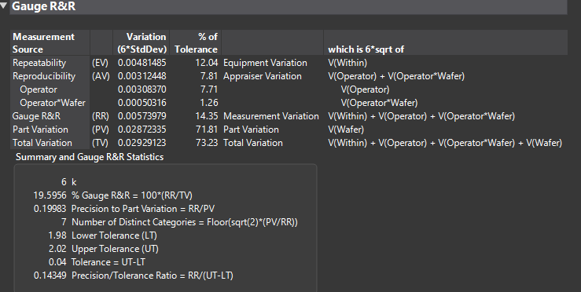 | 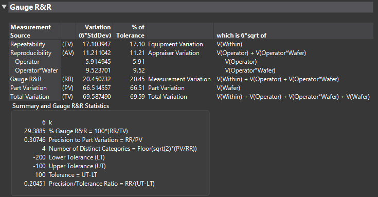 |

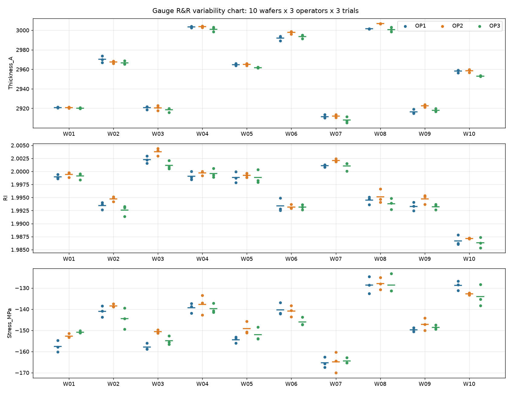

### Step 3: Screening DOE

A **2^(5-1) Resolution V fractional factorial** with 4 center points (20 runs, randomized), designed in JMP (DOE → Screening Design). Resolution V keeps all 5 main effects and all 10 two-factor interactions unconfounded in 16 runs instead of 32. Each run was processed on chamber T1-A by `src/run_doe.py`, with stress measured as the **average of 3 readings**, the fix from Step 2. The model (main effects + 2-factor interactions) was fit in JMP Fit Model and in `src/screening_analysis.py`. RMSE and t ratios match.

| Response | Significant effects (p < 0.05) | R² |
|---|---|---|
| Deposition rate | NH3/SiH4 (−), pressure (+), RF power (+), spacing (−) | 0.99 |
| WIW non-uniformity | Spacing, RF power, pressure, **Power×Spacing**, **Power×Pressure** | 0.95 |
| Refractive index | NH3/SiH4 (−), RF power (−) | 0.98 |
| Stress | Pressure, RF power, temperature, spacing, NH3/SiH4. No interactions. | 0.98 |

**Findings**
- **The gas ratio sets the film.** NH3/SiH4 is the largest effect on both rate and RI, so it is the primary knob for hitting the RI target.
- **Uniformity is driven by interactions.** Power×Spacing and Power×Pressure are significant, so uniformity can't be tuned one factor at a time.
- **Temperature is an independent stress knob.** It moves stress strongly but has no significant effect on RI, so stress can be adjusted without moving the RI target.
- **Strong curvature in every response** (center-point test p < 0.001). The 4 center points sit about +4 nm/min above the linear model's prediction for rate, while all 16 corner runs sit near −1. A first-order model can't describe the middle of the window, so **Step 4 uses a response surface design**.
- **An aliased effect, not a false positive.** Temp×NH3/SiH4 on uniformity (p = 0.049) looked like chance at first, but it came back significant in Step 4 (t = 3.9). The design generator is Spacing = Power×Press×Temp×NH3, so in this Resolution V design **Temp×NH3/SiH4 is aliased with Power×Press×Spacing**. Uniformity really does depend on power, pressure and spacing together (see Step 4), so the effect is real but carries the wrong label. Separating the two would need a fold-over or the full 2^5 factorial.

| JMP Effect Summary | Curvature: Dep_Rate residuals |
|---|---|
|  | 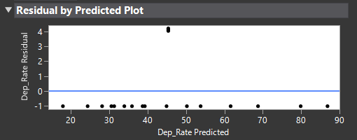 |

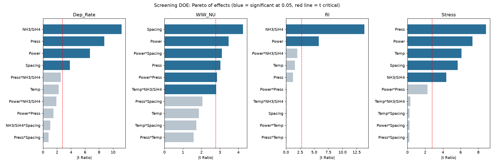

### Step 4: Response surface optimization

The screening design was **augmented** in JMP (DOE → Augment Design → Add Axial) into a **face-centered central composite design**: the original 20 runs plus 10 axial points and 2 center points, run as a second block after a chamber clean (32 runs total). The face-centered design keeps every run inside the equipment limits, and reusing the screening runs avoids a new 30-run experiment. The block effect was not significant for any response (p > 0.45), so it was dropped. A full quadratic model was fit in JMP (Fit Model → Response Surface) and in `src/rsm_analysis.py`, and the predictions match to 4 significant figures.

| Response | R² | R² adj | RMSE | Lack of fit p |
|---|---|---|---|---|
| Deposition rate | 0.997 | 0.991 | 1.47 nm/min | < 0.001 |
| WIW non-uniformity | 0.951 | 0.861 | 0.33 % | < 0.001 |
| Refractive index | 0.9996 | 0.9988 | 0.0024 | 0.29 |
| Stress | 0.998 | 0.995 | 5.7 MPa | 0.07 |

**Multi-response optimization.** Goals: maximize rate (40→80 nm/min), minimize non-uniformity (2.0→0.5 %), RI on target 2.00 ± 0.02 and stress on target −150 ± 50 MPa. Optimized with JMP's Prediction Profiler (Maximize Desirability) and with a Derringer-Suich desirability search in Python. Each candidate recipe was then **confirmed with 5 wafers** on a freshly cleaned chamber (`src/confirm.py`):

| Recipe | Power | Press | Temp | NH3/SiH4 | Spacing | Rate | WIW | RI | Stress | Result |
|---|---|---|---|---|---|---|---|---|---|---|
| JMP optimum | 583 W | 5.0 Torr | 400 °C | 3.10 | 300 mils | 71.6 | 0.80 % | 1.997 | −137.5 | 2/5 stress wafers outside PI |
| Python optimum | 600 W | 4.67 Torr | 384 °C | 2.92 | 300 mils | 79.2 | 0.41 % | 1.998 | −141.0 | Stress ~9 MPa off target |
| **Released recipe** | **600 W** | **4.67 Torr** | **400 °C** | **2.92** | **300 mils** | **77.7** | **0.50 %** | **2.001** | **−153.9** | **All responses on target** |

**Findings**
- **The confirmation runs caught a model bias.** Both optimizer recipes came back about 10 MPa less compressive than predicted. The bias is systematic, not random, and it is largest in the **corner of the window** where JMP's optimum sits (pressure and temperature both at their limits). A face-centered CCD has the fewest points in the corners, so the model is weakest there. Running only the model's prediction would have released an off-target recipe.
- **Step 3's independent knob fixed it.** Temperature moves stress strongly but RI only slightly, so raising it from 384 to 400 °C brought stress back to target without moving RI out of spec. The released recipe hits all four goals on all 5 confirmation wafers, judged against the specs.
- **The uniformity model is the weakest.** The thickness profile flips from center-thick to edge-thick across the window, so uniformity has a V-shaped minimum that a quadratic model can't follow (lack of fit p < 0.001, and prediction intervals that dip below zero). It over-predicts non-uniformity near the optimum (0.72 % predicted vs 0.50 % measured). A better approach would model the **signed center-to-edge profile**, which is smooth, and calculate uniformity from it.
- **Two factors finished at their limits** (600 W power, 300 mils spacing), so the true optimum may lie outside the tested window. The next experiment would extend those two ranges if the tool allows.

| JMP Prediction Profiler at maximum desirability |
|---|
|  |


### Step 5: Fleet variance components and chamber matching

The released recipe was run on **all 4 chambers: 5 days × 3 wafers per chamber, 49 sites per wafer** (60 wafers, 2,940 site measurements). Each day starts with a chamber clean and a small random day-to-day shift. Thickness spec is 3000 Å ± 2.5% (2925–3075 Å). `src/fleet_study.py` generates the data and runs the analysis. JMP reproduces every number: Variability Chart (nested) → Variance Components, Fit Y by X → Tukey HSD + Equivalence Test (±30 Å), and Process Capability.

**Where the variation comes from (baseline, same deposition time on every chamber):**

| Source (nested) | Std dev (Å) | % of variance |
|---|---|---|
| **Chamber** | 46.4 | **83.5%** |
| Day [Chamber] | 9.1 | 3.2% |
| Wafer [Chamber, Day] | 11.3 | 5.0% |
| Site (within wafer) | 14.6 | 8.3% |

Chamber explains 90% of the wafer-to-wafer variation (one-way R² = 0.90). Every chamber pair is statistically different (Tukey), and only one pair (T1-B vs T2-B) is **practically equivalent** within ±30 Å, even though it is also statistically different (p = 0.006). The capability Goal Plot shows similar spread on all 4 chambers but means pushed left and right: **a centering problem, not a spread problem**.

**Fix: per-chamber deposition time**, scaled from each chamber's baseline mean (T2-A +5.0 s, T2-B −3.2 s, T1-B −1.8 s, T1-A +0.6 s). Then the study was repeated:

| | Before matching | After matching |
|---|---|---|
| Chamber share of thickness variance | 83.5% | **0%** |
| Total thickness std dev | 50.7 Å | **24.1 Å** |
| Chamber pairs equivalent (±30 Å), wafer-level test | 1 of 6 | **6 of 6** |
| Chamber pairs equivalent (±30 Å), day-level test | 0 of 6 | **5 of 6** |
| Fleet thickness Ppk | 0.57 | **1.28** |
| Wafers out of spec (of 60) | 4 | **0** |

**Findings**
- **Matching the deposition time removed the dominant source of variation.** That fixes thickness centering with a recipe parameter, with no hardware change.
- **Day-to-day variation is now the largest component** (40% of what remains), so the next lever is the chamber's state after each clean: seasoning wafers and post-clean qual limits. The day estimate rests on only 16 degrees of freedom, so its jump from 9 to 15 Å is mostly sampling noise.
- **Single-chamber Ppk from 15 wafers is imprecise.** T1-A's Ppk fell from 1.68 to 1.02 even though its time changed by just 0.6 s. With n = 15, the 95% interval on a Ppk is about ±0.4 at Ppk 1.0 and ±0.6 at Ppk 1.7, so the fleet-level Ppk is the number to manage to.
- **Time matching only fixes thickness.** RI and stress still differ significantly between chambers (for example, T2-A runs about 25 MPa more compressive than T2-B), and within-wafer spread is a stable per-chamber signature (about 18 Å on T2-A vs 11 Å on T2-B). Everything is inside spec, but closing those gaps would take per-chamber power, gas or spacing offsets, because they come from hardware differences.
- **The stricter test needs more days.** The Tukey and equivalence tests above treat the 15 wafers per chamber as independent, but wafers from the same day share that day's shift. Repeating the tests on **day means** (5 per chamber, days as the independent units) keeps the overall conclusion: the chamber ANOVA goes from p < 10⁻⁹ to p = 0.65. But only **5 of 6 pairs** are then proven equivalent after matching. T1-A vs T2-A misses at p = 0.06 (a 12.6 Å gap, inside the margin but not yet proven with 5 days). Before release, I would run more days on those two chambers rather than claim equivalence on wafer-level data.

| JMP nested variance components (baseline) |
|---|
| 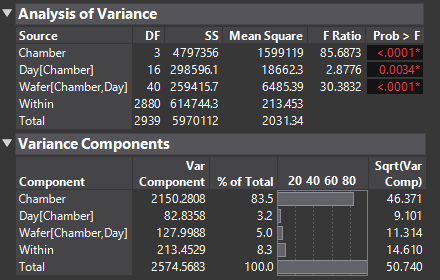 |

| Equivalence (±30 Å) before | Equivalence after |
|---|---|
| 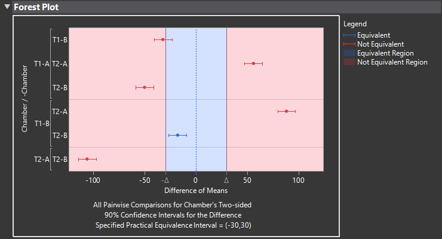 | 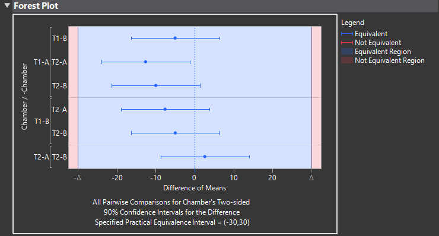 |

| Capability Goal Plot before | Goal Plot after |
|---|---|
| 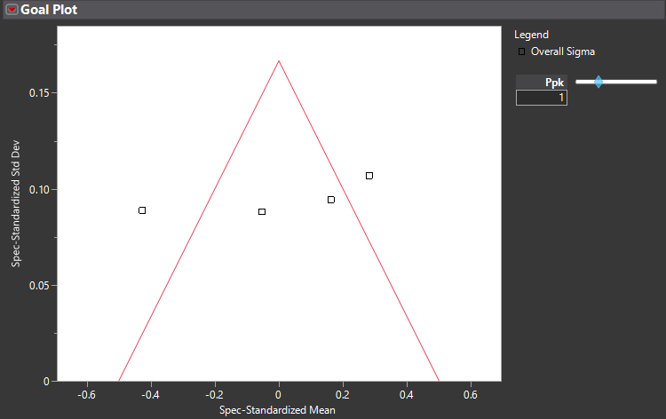 | 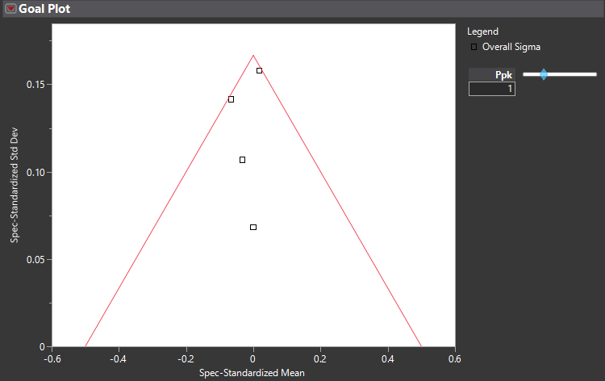 |

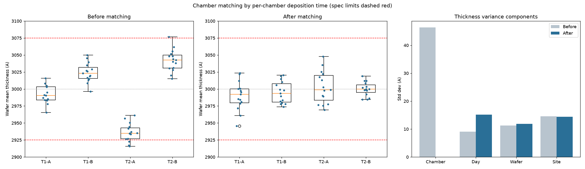

### Step 6: Yield driver analysis on real fab data (UCI SECOM)

**Data:** 1,567 production units from a real semiconductor fab, each with 590 anonymized sensor signals, a pass/fail result from in-line test, and a timestamp (July–October 2008). 104 fails (6.6%), 41,951 missing values (4.5%) [7]. `src/secom_analysis.py` runs the whole pipeline, and JMP Predictor Screening was used to check the sensor ranking.

**Cleaning:** removed 116 constant sensors, 28 sensors more than 50% empty and 6 sensors that never vary during the training period, which leaves **440**. The remaining gaps were filled with training-period medians.

**Time-ordered split.** The weekly fail rate fell from about 22% in July to about 3% in September, so the process was changing during collection. The first 70% of units (19 Jul – 26 Sep, 78 fails) were used for training and the last 30% (26 Sep – 17 Oct, 26 fails) only for testing. All screening and model fitting used training data only.

| Check | Result |
|---|---|
| Sensors with p < 0.05 (Mann-Whitney, training) | 75, but about 22 would pass by chance alone with 440 tests |
| Sensors surviving FDR control (Benjamini-Hochberg, q < 0.05) | **22** |
| Top sensor (both methods) | **S059**: #1 by Mann-Whitney and by random forest in Python and in JMP, with 10% of total importance in JMP, more than 6 times the #2 sensor |
| JMP vs Python top-20 forest rankings | 12 of 20 shared (both forests are random) |
| Top-10 screened sensors still significant in the later test period | **1 of 10** (S103) |
| PCA | Fails don't form a cluster; 83 components needed for 80% of the variance; of the first 5 components only PC2 shows a pass/fail shift |

| Model | ROC AUC, random 5-fold CV | **ROC AUC, later test period** | PR AUC (no skill = 0.055) | Fails caught inspecting riskiest 10% |
|---|---|---|---|---|
| Logistic regression, top 20 screened sensors | 0.74 | **0.56** | 0.087 | 23% (6 of 26) |
| Random forest, all 440 sensors | 0.74 | **0.57** | 0.067 | 8% |
| Logistic regression, 4 sensors stable across both halves of training | – | **0.47** | 0.060 | 4% |

**Findings**
- **Random cross-validation hides drift.** It mixes later units into training and reports ROC AUC 0.74. Tested on later production, the same models score 0.56–0.57, barely better than chance. On data like this, any validation that isn't ordered in time overstates what a model will do on the line.
- **The yield drivers changed over time.** 9 of the top 10 sensors that separated passes from fails during training stopped separating them in the later period, and requiring consistency within the training period didn't help either. The failure modes in October weren't the ones from July–September.
- **Multiple-testing control matters.** With 440 sensors, about 22 look "significant" at p < 0.05 by luck alone. FDR control keeps 22 that are very unlikely to be pure chance, and even most of those didn't carry forward in time.
- **One lead worth an engineering look: S103.** It's the only screened sensor that stayed significant in the test period (ROC AUC 0.65 in training, 0.71 in testing). It was picked after looking at the test data, so it's a hypothesis for the process engineers, not a validated predictor.
- **What I'd do in a fab:** treat sensor-based yield models as monitors that are retrained on a rolling window and checked against the most recent production, track signals like S059 and S103 on control charts, and tie fail clusters back to tool and lot history. That history is what SECOM's anonymized sensors can't provide.
- **Small-sample caveat:** the test period has only 26 fails, so differences of a few fails (for example the 23% vs 8% capture rates) carry wide uncertainty.

| JMP Predictor Screening (training period only) |
|---|
| 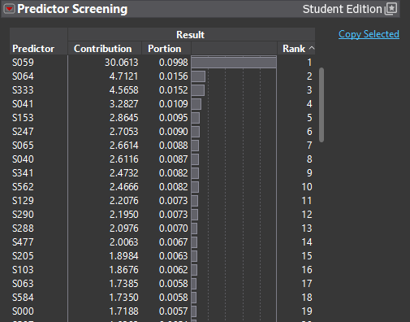 |

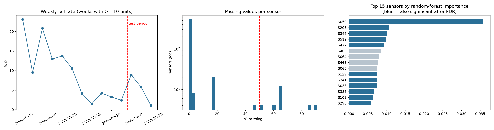
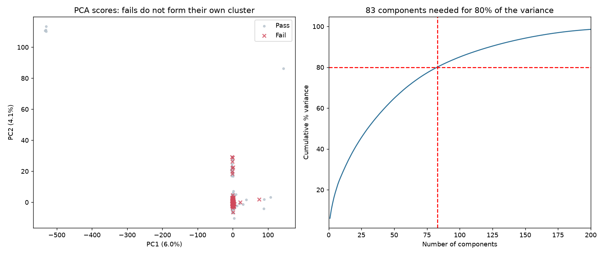
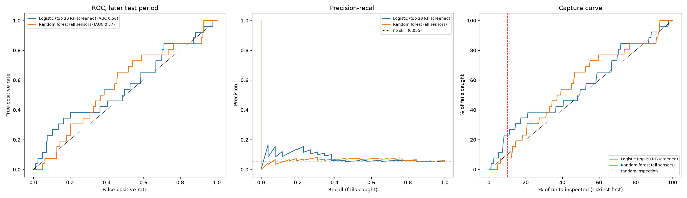

## The simulated process

| Factor | Range | Units |
|---|---|---|
| RF power | 300 – 600 | W |
| Pressure | 2 – 5 | Torr |
| Temperature | 300 – 400 | °C |
| NH3/SiH4 flow ratio | 2 – 8 | ratio |
| Electrode spacing | 300 – 600 | mils |

**Responses:** deposition rate, within-wafer non-uniformity (1σ % from a 49-point map), refractive index at 633 nm, film stress.

Each chamber has its own small offsets in rate, RI, stress and radial profile, along with drift between cleans and a small random shift each production day. Measurements come from a separate metrology model with repeatability and operator bias, so measurement noise can be separated from process noise.

### Model check against literature

`src/verify_trends.py` sweeps each factor and checks 15 response directions against published PECVD SiNx studies. All 15 pass:


- Rate rises with RF power and saturates [2, 3]. It peaks as pressure increases [2], and falls as NH3/SiH4 rises [3].
- RI falls as NH3/SiH4 and RF power rise [4, 5].
- Compressive stress eases with higher pressure, RF power and spacing [5, 6].
- Uniformity improves with higher temperature and pressure, and gets worse with wider spacing and higher RF power [1].

All coefficients, offsets and noise values are **illustrative**. They come from public literature, not from any company's tools or recipes.

## Getting started

```
python -m venv venv
venv\Scripts\activate          # Windows
pip install -r requirements.txt
cd src
python pecvd.py                # run the center recipe on all 4 chambers
python verify_trends.py        # literature trend check + plot
python gauge_rr.py             # Step 2: Gauge R&R data + ANOVA results
python run_doe.py ..\data\screening_design.csv          # Step 3: run the JMP design
python screening_analysis.py ..\data\screening_results.csv  # Step 3: effects + Pareto
python run_doe.py ..\data\rsm_design.csv                # Step 4: run the augmented CCD
python rsm_analysis.py ..\data\rsm_results.csv            # Step 4: RSM fit + optimum
python confirm.py ..\data\rsm_results.csv "RF_Power=600,Pressure=4.67,Temp=400,NH3_SiH4=2.92,Spacing=300"
python fleet_study.py baseline   # Step 5: fleet study, same dep time
python fleet_study.py matched    # Step 5: per-chamber dep time, before vs after
python secom_analysis.py         # Step 6: needs data/secom.data and data/secom_labels.data from UCI
```

## Project structure

```
src/     simulator (config.py, pecvd.py), metrology.py, analysis scripts
jmp/     JMP data tables, JSL scripts and report screenshots
data/    generated data (CSV) and the public UCI SECOM dataset
plots/   figures
```

## References

1. NECTEC, "PECVD silicon nitride deposition" trend summary (2005): https://www.nectec.or.th/nac2005/documents/20050329_MicroElectronics-01_Presentation.pdf
2. Stress-controllable SiNx films by PECVD, *Optoelectronics Letters* (2016): https://www.researching.cn/ArticlePdf/m00050/2016/12/4/OEL-2016-0285.pdf
3. Advanced Process Equipment for PECVD Silicon Nitride Deposition, *Materials Science (Medžiagotyra)*: https://matsc.ktu.lt/index.php/MatSc/article/view/26410
4. Choi et al., SiNx by low and high frequency PECVD, *J. KSDT* 13(4), 2014: https://koreascience.kr/journal/BDCHBX/v13n4.page?lang=en
5. PECVD silicon nitride process study, ECS Meeting Abstracts 203: https://www.electrochem.org/dl/ma/203/pdfs/0367.pdf
6. US Patent 7,192,855, "PECVD nitride film."
7. McCann, M. & Johnston, A. (2008). SECOM [Dataset]. UCI Machine Learning Repository. https://doi.org/10.24432/C54305 (CC BY 4.0)
