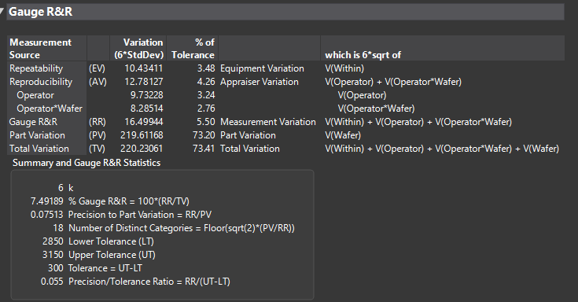
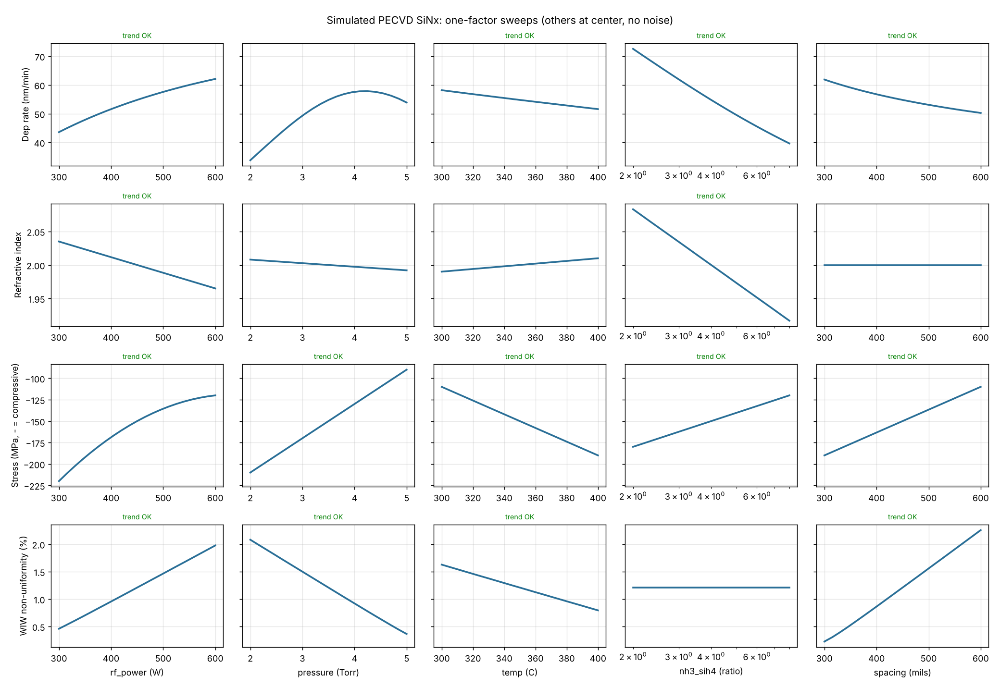

# Process Characterization & Optimization with DOE and MSA

**The problem:** Before a deposition process can be released or matched across chambers, an engineer has to answer four questions with data: *Can I trust my measurements? Which knobs actually matter? Where is the best operating window? Where does my variation come from?* This project answers each one with standard process engineering statistics, run in **JMP** and checked in **Python**.

**Case study:** a simulated single-wafer PECVD silicon nitride (SiNx) process across four chambers, plus real fab sensor data (UCI SECOM) for yield analysis.

> **Status:** In progress. The PECVD simulator and metrology models are complete and checked against published trends. The analysis steps come next.

---

## Plan

| Step | Method | Tool | Status |
|---|---|---|---|
| 1. PECVD chamber simulator | Physics-informed response model, 49-point wafer maps, 4 chambers | Python | Done |
| 2. Measurement system analysis | Crossed Gauge R&R (ellipsometer, stress gauge) | JMP + Python | In progress |
| 3. Factor screening | 2^(5-1) fractional factorial | JMP + Python | Planned |
| 4. Process window optimization | Central composite RSM, multi-response desirability | JMP + Python | Planned |
| 5. Variance sources and chamber matching | Nested variance components, ANOVA, Cpk per chamber | JMP + Python | Planned |
| 6. Yield driver analysis (real data) | Data cleaning, predictor screening, PCA, classification on UCI SECOM | JMP + Python | Planned |

## Results

### Step 2: Gauge R&R

A crossed study with 10 wafers × 3 operators × 3 trials, run in random order and analyzed with the AIAG ANOVA method in JMP (Variability Chart → Gauge R&R, k = 6). `src/gauge_rr.py` reproduces every number to rounding.

| Gauge | % GRR (study var.) | % Tolerance | Distinct categories | Verdict |
|---|---|---|---|---|
| Ellipsometer: thickness | 7.5% | 5.5% | 18 | Acceptable |
| Ellipsometer: refractive index | 19.6% | 14.3% | 7 | Marginal |
| Stress gauge | 29.4% | 20.5% | **4** | Marginal, cannot reliably tell wafers apart |

**Findings**
- **The thickness data can be trusted as-is** for the DOE.
- **The stress gauge needs action before a stress DOE.** It sits at the edge of AIAG's 30% limit, and with 4 distinct categories (AIAG requires at least 5) it can't reliably separate wafers. Repeatability (17.1% of tolerance) is larger than reproducibility (11.2%), so the problem is **the instrument, not the operators**.
- **Recommended fix: average 3 readings per wafer.** That cuts the repeatability SD by a factor of √3 and brings the gauge to about 22% GRR with 6 distinct categories, without new hardware. Then reproducibility becomes the larger term, and the next lever is a standard measurement procedure for all operators.

| Thickness | Refractive index | Stress |
|---|---|---|
|  |  |  |


## The simulated process

| Factor | Range | Units |
|---|---|---|
| RF power | 300 – 600 | W |
| Pressure | 2 – 5 | Torr |
| Temperature | 300 – 400 | °C |
| NH3/SiH4 flow ratio | 2 – 8 | ratio |
| Electrode spacing | 300 – 600 | mils |

**Responses:** deposition rate, within-wafer non-uniformity (1σ % from a 49-point map), refractive index at 633 nm, film stress.

Each chamber has its own small offsets in rate, RI, stress and radial profile, along with drift between cleans. Measurements come from a separate metrology model with repeatability and operator bias, so measurement noise can be separated from process noise.

### Model check against literature

`src/verify_trends.py` sweeps each factor and checks 15 response directions against published PECVD SiNx studies. All 15 pass:



- Rate rises with RF power and saturates [2, 3]. It peaks as pressure increases [2], and falls as NH3/SiH4 rises [3].
- RI falls as NH3/SiH4 and RF power rise [4, 5].
- Compressive stress eases with higher pressure, RF power and spacing [5, 6].
- Uniformity improves with higher temperature and pressure, and gets worse with wider spacing and higher RF power [1].

All coefficients, offsets and noise values are **illustrative**. They come from public literature, not from any company's tools or recipes.

## Getting started

```
python -m venv venv
venv\Scripts\activate          # Windows
pip install -r requirements.txt
cd src
python pecvd.py                # run the center recipe on all 4 chambers
python verify_trends.py        # literature trend check + plot
python gauge_rr.py             # Step 2: Gauge R&R data + ANOVA results
```

## Project structure

```
src/     simulator (config.py, pecvd.py), metrology.py, analysis scripts
jmp/     JMP data tables, JSL scripts and report screenshots
data/    generated and public datasets (CSV)
plots/   figures
```

## References

1. NECTEC, "PECVD silicon nitride deposition" trend summary (2005): https://www.nectec.or.th/nac2005/documents/20050329_MicroElectronics-01_Presentation.pdf
2. Stress-controllable SiNx films by PECVD, *Optoelectronics Letters* (2016): https://www.researching.cn/ArticlePdf/m00050/2016/12/4/OEL-2016-0285.pdf
3. Advanced Process Equipment for PECVD Silicon Nitride Deposition, *Materials Science (Medžiagotyra)*: https://matsc.ktu.lt/index.php/MatSc/article/view/26410
4. Choi et al., SiNx by low and high frequency PECVD, *J. KSDT* 13(4), 2014: https://koreascience.kr/journal/BDCHBX/v13n4.page?lang=en
5. PECVD silicon nitride process study, ECS Meeting Abstracts 203: https://www.electrochem.org/dl/ma/203/pdfs/0367.pdf
6. US Patent 7,192,855, "PECVD nitride film."
7. McCann, M. & Johnston, A. (2008). SECOM [Dataset]. UCI Machine Learning Repository. https://doi.org/10.24432/C54305 (CC BY 4.0)
