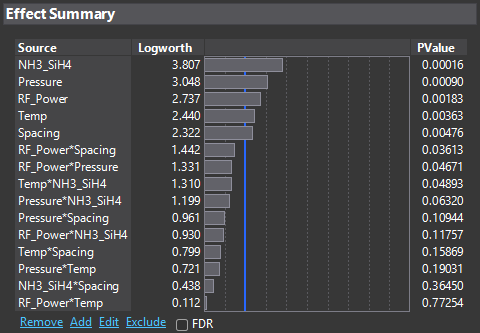
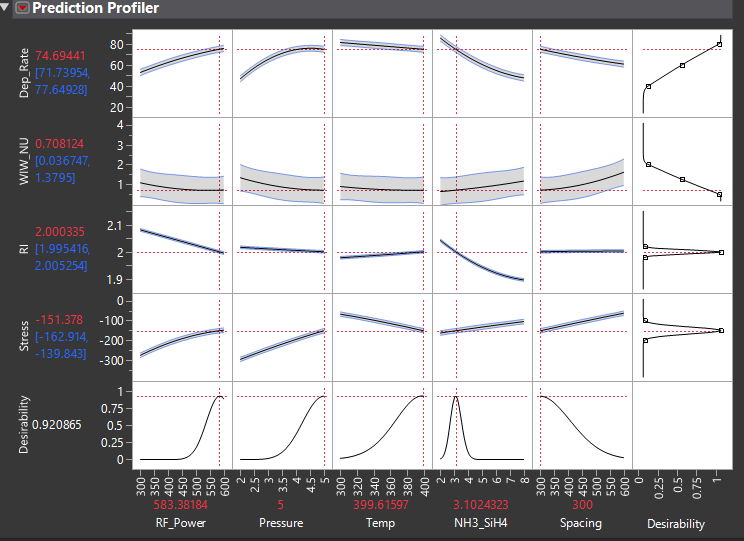
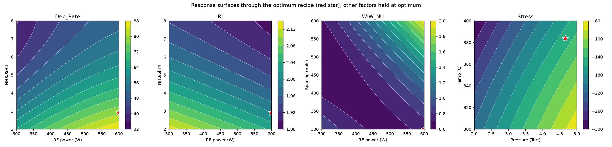

# Process Characterization & Optimization with DOE and MSA

**The problem:** Before a deposition process can be released or matched across chambers, an engineer has to answer four questions with data: *Can I trust my measurements? Which knobs actually matter? Where is the best operating window? Where does my variation come from?* This project answers each one with standard process engineering statistics, run in **JMP** and checked in **Python**.

**Case study:** a simulated single-wafer PECVD silicon nitride (SiNx) process across four chambers, plus real fab sensor data (UCI SECOM) for yield analysis.

> **Status:** In progress. Steps 1–4 are complete: simulator, Gauge R&R, screening DOE and response surface optimization with confirmation runs. Next is variance components and chamber matching.

---

## Plan

| Step | Method | Tool | Status |
|---|---|---|---|
| 1. PECVD chamber simulator | Physics-informed response model, 49-point wafer maps, 4 chambers | Python | Done |
| 2. Measurement system analysis | Crossed Gauge R&R (ellipsometer, stress gauge) | JMP + Python | Done |
| 3. Factor screening | 2^(5-1) fractional factorial | JMP + Python | Done |
| 4. Process window optimization | Central composite RSM, multi-response desirability, confirmation runs | JMP + Python | Done |
| 5. Variance sources and chamber matching | Nested variance components, ANOVA, Cpk per chamber | JMP + Python | Planned |
| 6. Yield driver analysis (real data) | Data cleaning, predictor screening, PCA, classification on UCI SECOM | JMP + Python | Planned |

## Results

### Step 2: Gauge R&R

A crossed study with 10 wafers × 3 operators × 3 trials, run in random order and analyzed with the AIAG ANOVA method in JMP (Variability Chart → Gauge R&R, k = 6). `src/gauge_rr.py` reproduces every number to rounding.

| Gauge | % GRR (study var.) | % Tolerance | Distinct categories | Verdict |
|---|---|---|---|---|
| Ellipsometer: thickness | 7.5% | 5.5% | 18 | Acceptable |
| Ellipsometer: refractive index | 19.6% | 14.3% | 7 | Marginal |
| Stress gauge | 29.4% | 20.5% | **4** | Marginal, cannot reliably tell wafers apart |

**Findings**
- **The thickness data can be trusted as-is** for the DOE.
- **The stress gauge needs action before a stress DOE.** It sits at the edge of AIAG's 30% limit, and with 4 distinct categories (AIAG requires at least 5) it can't reliably separate wafers. Repeatability (17.1% of tolerance) is larger than reproducibility (11.2%), so the problem is **the instrument, not the operators**.
- **Recommended fix: average 3 readings per wafer.** That cuts the repeatability SD by a factor of √3 and brings the gauge to about 22% GRR with 6 distinct categories, without new hardware. Then reproducibility becomes the larger term, and the next lever is a standard measurement procedure for all operators.

| Thickness | Refractive index | Stress |
|---|---|---|
|  |  |  |


### Step 3: Screening DOE

A **2^(5-1) Resolution V fractional factorial** with 4 center points (20 runs, randomized), designed in JMP (DOE → Screening Design). Resolution V keeps all 5 main effects and all 10 two-factor interactions unconfounded in 16 runs instead of 32. Each run was processed on chamber T1-A by `src/run_doe.py`, with stress measured as the **average of 3 readings**, the fix from Step 2. The model (main effects + 2-factor interactions) was fit in JMP Fit Model and in `src/screening_analysis.py`. RMSE and t ratios match.

| Response | Significant effects (p < 0.05) | R² |
|---|---|---|
| Deposition rate | NH3/SiH4 (−), pressure (+), RF power (+), spacing (−) | 0.99 |
| WIW non-uniformity | Spacing, RF power, pressure, **Power×Spacing**, **Power×Pressure** | 0.95 |
| Refractive index | NH3/SiH4 (−), RF power (−) | 0.98 |
| Stress | Pressure, RF power, temperature, spacing, NH3/SiH4. No interactions. | 0.98 |

**Findings**
- **The gas ratio sets the film.** NH3/SiH4 is the largest effect on both rate and RI, so it is the primary knob for hitting the RI target.
- **Uniformity is driven by interactions.** Power×Spacing and Power×Pressure are significant, so uniformity can't be tuned one factor at a time.
- **Temperature is an independent stress knob.** It moves stress strongly but has no significant effect on RI, so stress can be adjusted without moving the RI target.
- **Strong curvature in every response** (center-point test p < 0.001). The 4 center points sit about +4 nm/min above the linear model's prediction for rate, while all 16 corner runs sit near −1. A first-order model can't describe the middle of the window, so **Step 4 uses a response surface design**.
- **An aliased effect, not a false positive.** Temp×NH3/SiH4 on uniformity (p = 0.049) looked like chance at first, but it came back significant in Step 4 (t = 3.9). The design generator is Spacing = Power×Press×Temp×NH3, so in this Resolution V design **Temp×NH3/SiH4 is aliased with Power×Press×Spacing**. Uniformity really does depend on power, pressure and spacing together (see Step 4), so the effect is real but carries the wrong label. Separating the two would need a fold-over or the full 2^5 factorial.

| JMP Effect Summary | Curvature: Dep_Rate residuals |
|---|---|
|  |  |


### Step 4: Response surface optimization

The screening design was **augmented** in JMP (DOE → Augment Design → Add Axial) into a **face-centered central composite design**: the original 20 runs plus 10 axial points and 2 center points, run as a second block after a chamber clean (32 runs total). The face-centered design keeps every run inside the equipment limits, and reusing the screening runs avoids a new 30-run experiment. The block effect was not significant for any response (p > 0.45), so it was dropped. A full quadratic model was fit in JMP (Fit Model → Response Surface) and in `src/rsm_analysis.py`, and the predictions match to 4 significant figures.

| Response | R² | R² adj | RMSE | Lack of fit p |
|---|---|---|---|---|
| Deposition rate | 0.997 | 0.991 | 1.47 nm/min | < 0.001 |
| WIW non-uniformity | 0.951 | 0.861 | 0.33 % | < 0.001 |
| Refractive index | 0.9996 | 0.9988 | 0.0024 | 0.29 |
| Stress | 0.998 | 0.995 | 5.7 MPa | 0.07 |

**Multi-response optimization.** Goals: maximize rate (40→80 nm/min), minimize non-uniformity (2.0→0.5 %), RI on target 2.00 ± 0.02 and stress on target −150 ± 50 MPa. Optimized with JMP's Prediction Profiler (Maximize Desirability) and with a Derringer-Suich desirability search in Python. Each candidate recipe was then **confirmed with 5 wafers** on a freshly cleaned chamber (`src/confirm.py`):

| Recipe | Power | Press | Temp | NH3/SiH4 | Spacing | Rate | WIW | RI | Stress | Result |
|---|---|---|---|---|---|---|---|---|---|---|
| JMP optimum | 583 W | 5.0 Torr | 400 °C | 3.10 | 300 mils | 71.6 | 0.80 % | 1.997 | −137.5 | 2/5 stress wafers outside PI |
| Python optimum | 600 W | 4.67 Torr | 384 °C | 2.92 | 300 mils | 79.2 | 0.41 % | 1.998 | −141.0 | Stress ~9 MPa off target |
| **Released recipe** | **600 W** | **4.67 Torr** | **400 °C** | **2.92** | **300 mils** | **77.7** | **0.50 %** | **2.001** | **−153.9** | **All responses on target** |

**Findings**
- **The confirmation runs caught a model bias.** Both optimizer recipes came back about 10 MPa less compressive than predicted. The bias is systematic, not random, and it is largest in the **corner of the window** where JMP's optimum sits (pressure and temperature both at their limits). A face-centered CCD has the fewest points in the corners, so the model is weakest there. Running only the model's prediction would have released an off-target recipe.
- **Step 3's independent knob fixed it.** Temperature moves stress strongly but RI only slightly, so raising it from 384 to 400 °C brought stress back to target without moving RI out of spec. The released recipe hits all four goals on all 5 confirmation wafers, judged against the specs.
- **The uniformity model is the weakest.** The thickness profile flips from center-thick to edge-thick across the window, so uniformity has a V-shaped minimum that a quadratic model can't follow (lack of fit p < 0.001, and prediction intervals that dip below zero). It over-predicts non-uniformity near the optimum (0.72 % predicted vs 0.50 % measured). A better approach would model the **signed center-to-edge profile**, which is smooth, and calculate uniformity from it.
- **Two factors finished at their limits** (600 W power, 300 mils spacing), so the true optimum may lie outside the tested window. The next experiment would extend those two ranges if the tool allows.

| JMP Prediction Profiler at maximum desirability |
|---|
|  |



## The simulated process

| Factor | Range | Units |
|---|---|---|
| RF power | 300 – 600 | W |
| Pressure | 2 – 5 | Torr |
| Temperature | 300 – 400 | °C |
| NH3/SiH4 flow ratio | 2 – 8 | ratio |
| Electrode spacing | 300 – 600 | mils |

**Responses:** deposition rate, within-wafer non-uniformity (1σ % from a 49-point map), refractive index at 633 nm, film stress.

Each chamber has its own small offsets in rate, RI, stress and radial profile, along with drift between cleans. Measurements come from a separate metrology model with repeatability and operator bias, so measurement noise can be separated from process noise.

### Model check against literature

`src/verify_trends.py` sweeps each factor and checks 15 response directions against published PECVD SiNx studies. All 15 pass:


- Rate rises with RF power and saturates [2, 3]. It peaks as pressure increases [2], and falls as NH3/SiH4 rises [3].
- RI falls as NH3/SiH4 and RF power rise [4, 5].
- Compressive stress eases with higher pressure, RF power and spacing [5, 6].
- Uniformity improves with higher temperature and pressure, and gets worse with wider spacing and higher RF power [1].

All coefficients, offsets and noise values are **illustrative**. They come from public literature, not from any company's tools or recipes.

## Getting started

```
python -m venv venv
venv\Scripts\activate          # Windows
pip install -r requirements.txt
cd src
python pecvd.py                # run the center recipe on all 4 chambers
python verify_trends.py        # literature trend check + plot
python gauge_rr.py             # Step 2: Gauge R&R data + ANOVA results
python run_doe.py ..\data\screening_design.csv          # Step 3: run the JMP design
python screening_analysis.py ..\data\screening_results.csv  # Step 3: effects + Pareto
python run_doe.py ..\data\rsm_design.csv                # Step 4: run the augmented CCD
python rsm_analysis.py ..\data\rsm_results.csv            # Step 4: RSM fit + optimum
python confirm.py ..\data\rsm_results.csv "RF_Power=600,Pressure=4.67,Temp=400,NH3_SiH4=2.92,Spacing=300"
```

## Project structure

```
src/     simulator (config.py, pecvd.py), metrology.py, analysis scripts
jmp/     JMP data tables, JSL scripts and report screenshots
data/    generated and public datasets (CSV)
plots/   figures
```

## References

1. NECTEC, "PECVD silicon nitride deposition" trend summary (2005): https://www.nectec.or.th/nac2005/documents/20050329_MicroElectronics-01_Presentation.pdf
2. Stress-controllable SiNx films by PECVD, *Optoelectronics Letters* (2016): https://www.researching.cn/ArticlePdf/m00050/2016/12/4/OEL-2016-0285.pdf
3. Advanced Process Equipment for PECVD Silicon Nitride Deposition, *Materials Science (Medžiagotyra)*: https://matsc.ktu.lt/index.php/MatSc/article/view/26410
4. Choi et al., SiNx by low and high frequency PECVD, *J. KSDT* 13(4), 2014: https://koreascience.kr/journal/BDCHBX/v13n4.page?lang=en
5. PECVD silicon nitride process study, ECS Meeting Abstracts 203: https://www.electrochem.org/dl/ma/203/pdfs/0367.pdf
6. US Patent 7,192,855, "PECVD nitride film."
7. McCann, M. & Johnston, A. (2008). SECOM [Dataset]. UCI Machine Learning Repository. https://doi.org/10.24432/C54305 (CC BY 4.0)
